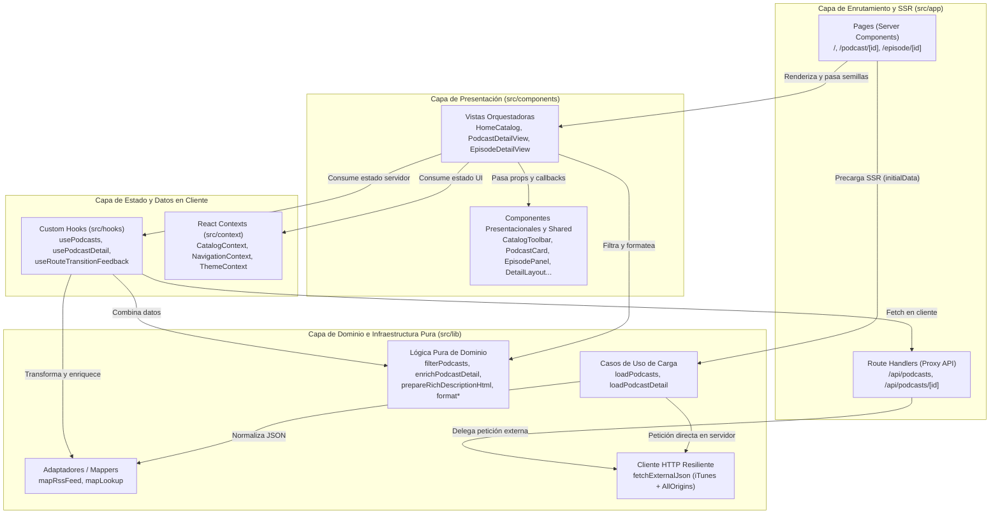
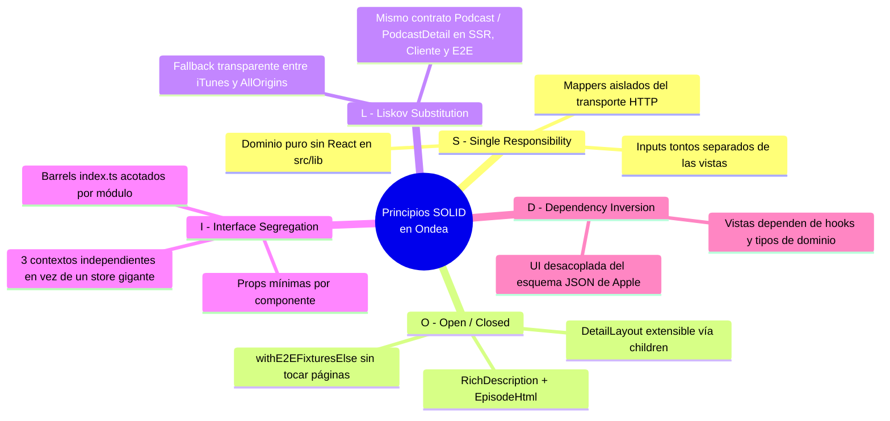
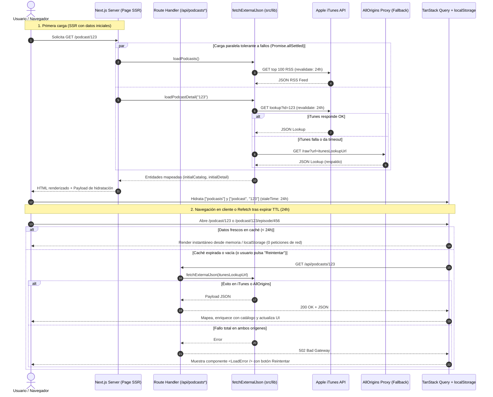
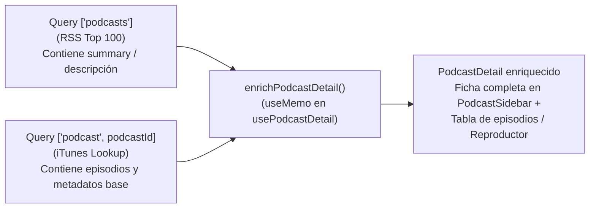
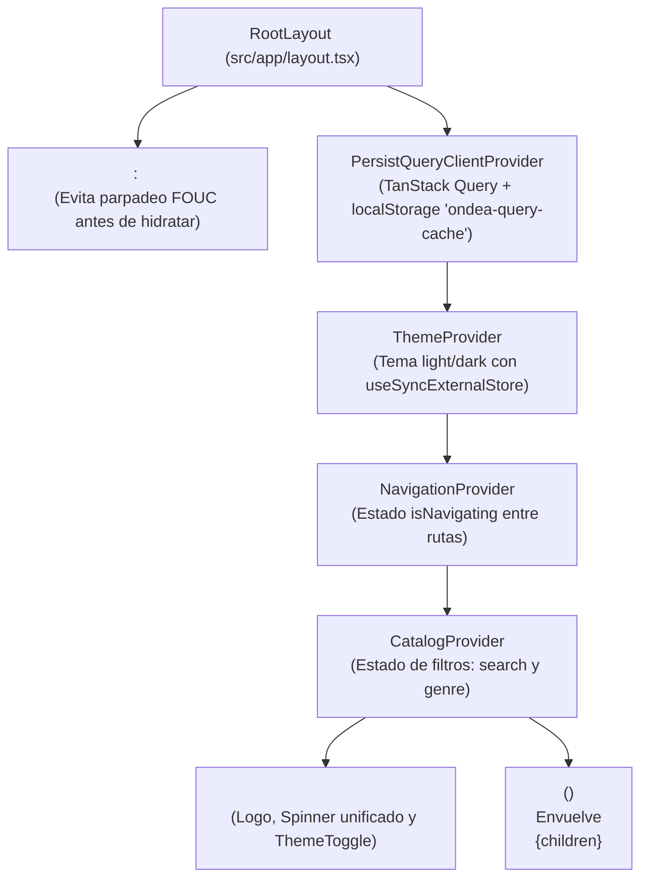
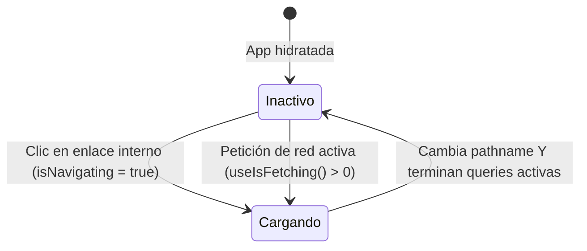
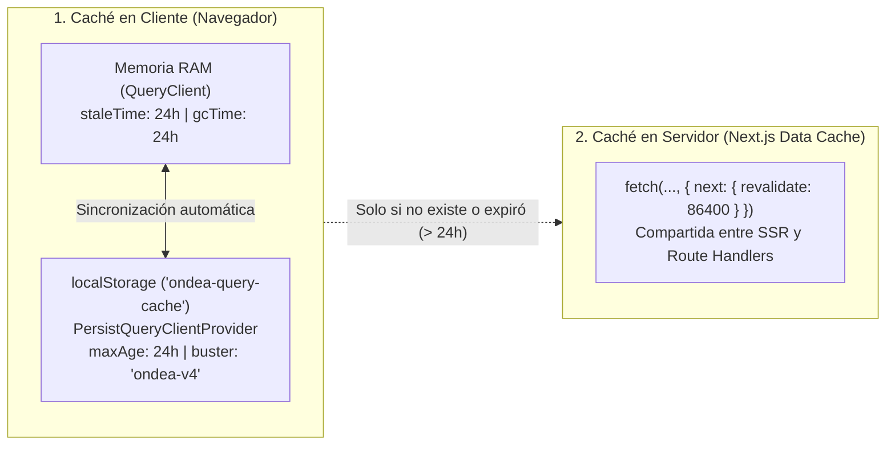

# Ondea

Catálogo interactivo de los **100 podcasts musicales más populares de Apple**. Permite filtrar el catálogo en tiempo real por título, autor y género, explorar la ficha detallada de cada podcast con su listado de episodios y reproducir el audio de cada episodio mediante el reproductor nativo HTML5. Todas las rutas son enlazables (_deep-linking_) y mantienen la navegación completa del historial del navegador.

---

## Tabla de contenidos

1. [Stack tecnológico](#stack-tecnológico)
2. [Cómo ejecutar el proyecto](#cómo-ejecutar-el-proyecto)
3. [Rutas de la aplicación](#rutas-de-la-aplicación)
4. [Arquitectura general y estructura del proyecto](#arquitectura-general-y-estructura-del-proyecto)
5. [Aplicación de los principios SOLID](#aplicación-de-los-principios-solid)
6. [Manejo de peticiones asíncronas y flujo de datos](#manejo-de-peticiones-asíncronas-y-flujo-de-datos)
7. [Arquitectura de Contextos y gestión de estado](#arquitectura-de-contextos-y-gestión-de-estado)
8. [Estrategia de caché en doble capa (24 h)](#estrategia-de-caché-en-doble-capa-24-h)
9. [Decisiones de diseño](#decisiones-de-diseño)
10. [Catálogo de componentes](#catálogo-de-componentes)
11. [Tests, lint y formato](#tests-lint-y-formato)
12. [Git, compatibilidad, accesibilidad y despliegue](#git-compatibilidad-accesibilidad-y-despliegue)

---

## Stack tecnológico

| Pieza                         | Para qué                                                                                               |
| ----------------------------- | ------------------------------------------------------------------------------------------------------ |
| **Next.js 16 (App Router)**   | Rutas basadas en sistema de ficheros, SSR, Route Handlers (proxy) y empaquetado con Turbopack          |
| **React 19 + React Compiler** | UI por componentes, `<ViewTransition>` para transiciones de vista y optimización automática de renders |
| **TypeScript (`strict`)**     | Contratos estáticos del dominio, respuestas externas de iTunes y props de componentes                  |
| **React Context API**         | Estado de interfaz en cliente: búsqueda, género, indicador de navegación y tema visual                 |
| **TanStack Query v5**         | Caché asíncrona en cliente, deduplicación, reintentos y persistencia en `localStorage`                 |
| **CSS propio (Tokens + BEM)** | Variables CSS, nomenclatura BEM y _media queries_, sin librerías de componentes externas               |
| **Vitest + Testing Library**  | Tests unitarios y de integración de dominio, hooks, contextos, componentes y rutas en `src/test/`      |
| **Playwright**                | Tests _end-to-end_ deterministas (éxito y fallo de red) en `src/test/e2e/` y `e2e/`                    |
| **ESLint 9 + Prettier**       | Cero alertas de lint y formato de código uniforme                                                      |

Turbopack cumple el papel de empaquetador: en `pnpm dev` los _assets_ se sirven sin minificar (con recarga en caliente); `pnpm build` los concatena, optimiza y minifica para producción, y `pnpm start` sirve ese artefacto.

No se utilizan librerías de componentes (antd, MUI, reactstrap ni similares). Cada control visible está escrito a medida en este repositorio. `lucide-react` únicamente aporta los iconos vectoriales del logo y del selector de tema.

---

## Cómo ejecutar el proyecto

Requisitos previos: **Node.js 20+** y **pnpm 11+**.

### Modo desarrollo

```bash
pnpm install
pnpm dev
```

Abre [http://localhost:3000](http://localhost:3000) en tu navegador.

### Modo producción

```bash
pnpm build
pnpm start
```

`pnpm build && pnpm start` es suficiente para desplegar el mismo artefacto en cualquier entorno Node.js. No hace falta levantar un servidor adicional para los datos: los _Route Handlers_ de Next.js actúan como proxy HTTP.

---

## Rutas de la aplicación

| Vista                   | URL                                        | Tipo de ruta                             | Responsabilidad principal                                                   |
| ----------------------- | ------------------------------------------ | ---------------------------------------- | --------------------------------------------------------------------------- |
| **Listado principal**   | `/`                                        | Página (SSR + Client Hydration)          | Catálogo de los 100 podcasts con filtrado por texto y género                |
| **Detalle de podcast**  | `/podcast/{podcastId}`                     | Página dinámica (SSR + Client Hydration) | Barra lateral del podcast y listado completo de episodios                   |
| **Detalle de episodio** | `/podcast/{podcastId}/episode/{episodeId}` | Página dinámica (SSR + Client Hydration) | Barra lateral del podcast, descripción HTML saneada y reproductor `<audio>` |
| **Proxy de catálogo**   | `/api/podcasts`                            | Route Handler (`GET`)                    | Proxy hacia el RSS Top 100 de Apple con _fallback_ a AllOrigins             |
| **Proxy de detalle**    | `/api/podcasts/{podcastId}`                | Route Handler (`GET`)                    | Proxy hacia el endpoint Lookup de Apple con _fallback_ a AllOrigins         |

---

## Arquitectura general y estructura del proyecto

El código está organizado por capas con límites de dependencia estrictos y dirección única (de presentación hacia dominio):

```text
src/
├── app/                        # Capa de enrutamiento, SSR y puntos de entrada HTTP
│   ├── api/podcasts/           # Route Handlers (proxy HTTP hacia Apple iTunes + fallback)
│   ├── podcast/[podcastId]/    # Rutas dinámicas de ficha de podcast y de episodio
│   ├── layout.tsx              # RootLayout (fuentes, ThemeScript, Providers, AppHeader, PageTransition)
│   └── page.tsx                # Ruta raíz (/) con precarga SSR del catálogo
├── components/                 # Capa de presentación (UI dividida por dominio funcional)
│   ├── catalog/                # HomeCatalog, CatalogToolbar, CatalogGrid, SearchInput, GenreSelect, PodcastCard
│   ├── podcast/                # PodcastDetailView, PodcastSidebar, EpisodePanel
│   ├── episode/                # EpisodeDetailView, EpisodeArticle, EpisodeHtml
│   ├── layout/                 # AppHeader, Providers, PageTransition, ThemeScript, ThemeToggle, Spinner
│   ├── shared/                 # DetailLayout, DetailSkeleton, LoadError, RichDescription
│   └── index.ts                # Barrel raíz consumido por src/app
├── hooks/                      # Capa de acceso a datos en cliente y efectos de navegación
│   ├── use-podcasts/           # Query del listado de podcasts (["podcasts"])
│   ├── use-podcast-detail/     # Query del detalle (["podcast", id]) + enriquecimiento con catálogo
│   └── use-route-transition-feedback/ # Detección de clics en enlaces internos para feedback visual
├── context/                    # Capa de estado de interfaz (React Context API)
│   ├── catalog-context/        # Estado de búsqueda (search) y filtro de género (genre)
│   ├── navigation-context/     # Estado booleano de transición entre rutas (isNavigating)
│   └── theme-context/          # Estado y persistencia del tema claro/oscuro (light | dark)
├── lib/                        # Capa de dominio y utilidades puras (0 dependencias de React)
│   ├── cache/                  # Validación pura de vigencia de caché (isCacheFresh)
│   ├── catalog/                # Lógica de filtrado (filterPodcasts), géneros (uniqueGenres) y paginación
│   ├── description-html/       # Sanitizador HTML basado en allowlist (prepareRichDescriptionHtml)
│   ├── e2e-fixtures/           # Conmutador de datos deterministas para pruebas Playwright
│   ├── enrich-podcast-detail/  # Cruce de metadatos entre el catálogo RSS y el lookup del podcast
│   ├── fetch-external/         # Cliente HTTP con revalidación de 24 h y fallback a AllOrigins
│   ├── format/                 # Formateadores puros de fechas (formatDate) y duraciones (formatDuration)
│   ├── load-podcasts/          # Casos de uso de carga en servidor (loadPodcasts, loadPodcastDetail)
│   ├── mappers/                # Adaptadores de contratos crudos de iTunes a entidades de dominio
│   ├── pagination-window/      # Cálculo de ventana deslizante de paginación (getPaginationWindow)
│   ├── query-client/           # Configuración de QueryClient y persister en localStorage
│   ├── constants.ts            # Constantes de dominio, TTLs, límites y constructores de URL
│   └── types.ts                # Contratos TypeScript de dominio y payloads de iTunes
├── styles/                     # Arquitectura CSS con variables (tokens.css) y bloques BEM por pantalla
└── test/                       # Espejo exacto de src/ para tests unitarios, de integración y E2E
```

### Diagrama de arquitectura por capas



---

## Aplicación de los principios SOLID

La arquitectura del proyecto se ha diseñado aplicando los cinco principios **SOLID** adaptados al ecosistema de React 19, Next.js App Router y TypeScript:



### 1. S — Single Responsibility Principle (Responsabilidad Única)

Cada módulo, hook o componente tiene **una única razón para cambiar**:

- **Transformación de datos (`src/lib/mappers/mappers.ts`)**: `mapRssFeed` y `mapLookup` solo saben convertir el esquema propietario de Apple (`im:name`, `im:artist`, `wrapperType`) a las entidades limpias `Podcast`, `Episode` y `PodcastDetail`. Si Apple cambia su JSON, solo cambia este archivo.
- **Transporte y resiliencia (`src/lib/fetch-external/fetch-external.ts`)**: `fetchExternalJson` solo gestiona la petición HTTP, la política de revalidación (`DAY_SECONDS`) y el reintento mediante el proxy de respaldo (`allorigins`). No conoce qué tipo de datos transporta.
- **Saneado de seguridad (`src/lib/description-html/description-html.ts`)**: `prepareRichDescriptionHtml` se encarga exclusivamente de limpiar etiquetas peligrosas (`<script>`, `<style>`, atributos `on*`) y validar URLs seguras en enlaces.
- **Controles de formulario puros (`CatalogSearchInput`, `CatalogGenreSelect`)**: solo pintan un `<input>` o `<select>` y notifican el cambio mediante un _callback_. No leen contextos ni filtran arrays.

### 2. O — Open/Closed Principle (Abierto a extensión, cerrado a modificación)

Las piezas están diseñadas para extender su comportamiento por composición sin modificar su código fuente:

- **Layout compartido de detalle (`DetailLayout`)**: encapsula la estructura común de dos columnas (`PodcastSidebar` a la izquierda + contenedor principal a la derecha) y recibe `children: ReactNode`. Así se reutiliza intacto en la vista de podcast (`EpisodePanel`), en la vista de episodio (`EpisodeArticle`) y en el estado de episodio no encontrado.
- **Conmutación de entornos (`withE2EFixturesElse`)**: permite inyectar _fixtures_ deterministas o simular caídas de red en tests E2E sin introducir condicionales de pruebas dentro de los componentes ni de las páginas SSR.
- **Composición de descripciones (`RichDescription` y `EpisodeHtml`)**: `RichDescription` resuelve el renderizado seguro de texto plano o HTML, mientras que `EpisodeHtml` actúa como adaptador semántico para el artículo del episodio.

### 3. L — Liskov Substitution Principle (Sustitución de Liskov)

Cualquier proveedor de datos que cumpla los contratos `Podcast[]` o `PodcastDetail` es intercambiable sin alterar el comportamiento de las vistas:

- **Simetría entre SSR, API y Fixtures**: `loadPodcasts` (servidor en producción), `loadPodcastsE2E` (servidor en modo E2E) y `fetchPodcasts` (cliente vía `/api/podcasts`) devuelven exactamente la misma estructura `Podcast[]`. Gracias a ello, `usePodcasts(initialPodcasts)` hidrata la caché de TanStack Query de forma transparente sin importar el origen del dato.
- **Respaldo transparente en red**: `fetchExternalJson<T>` devuelve `Promise<T>` tanto si responde directamente `itunes.apple.com` como si responde el espejo `api.allorigins.win`.

### 4. I — Interface Segregation Principle (Segregación de Interfaces)

Ningún componente o consumidor es forzado a depender de datos o métodos que no utiliza:

- **Segregación de contextos**: en lugar de un único `AppContext` monolítico (que provocaría re-renderizados globales en toda la aplicación al escribir en el buscador), el estado de UI se divide en tres contextos independientes y cohesivos: `ThemeContext`, `NavigationContext` y `CatalogContext`.
- **Props acotadas**: `PodcastCard` solo recibe `{ podcast, priority }`; `LoadError` solo recibe `{ message, onRetry }`; `PodcastDetailSeed` define propiedades opcionales (`initialCatalog?`, `initialDetail?`) para no obligar a pasar semillas en entornos de test de cliente.
- **API pública controlada mediante _barrels_ (`index.ts`)**: las páginas en `src/app/` solo importan las vistas de alto nivel expuestas en `src/components/index.ts`, manteniendo los subcomponentes internos encapsulados dentro de cada carpeta (`catalog`, `podcast`, `episode`, `layout`, `shared`).

### 5. D — Dependency Inversion Principle (Inversión de Dependencias)

Los módulos de alto nivel (vistas y páginas) no dependen de los detalles de bajo nivel (URLs de iTunes, `fetch`, `localStorage`), sino de abstracciones:

- **Vistas desacopladas de la infraestructura**: `HomeCatalog`, `PodcastDetailView` y `EpisodeDetailView` consumen los hooks `usePodcasts` y `usePodcastDetail` y operan sobre las interfaces de dominio `Podcast` y `Episode`. Ningún componente de interfaz conoce qué es un feed RSS de Apple, ni cómo funciona `localStorage`, ni qué código HTTP devuelve el proxy.

---

## Manejo de peticiones asíncronas y flujo de datos

El proyecto implementa una estrategia **híbrida SSR + Cliente con caché compartida y tolerancia a fallos**. Esto resuelve dos problemas clásicos al consumir la API de Apple iTunes:

1. **Límites de CORS en el navegador**: iTunes no siempre incluye cabeceras CORS válidas para peticiones directas desde el navegador.
2. **Inconsistencia de metadatos en el endpoint de Lookup**: el endpoint `/lookup` de Apple devuelve la lista de episodios, pero suele omitir el campo `summary` (descripción general del podcast), que sí viene en el feed RSS del Top 100.

### 1. Ciclo completo: SSR, Hidratación, Proxy y Fallback



### 2. Enriquecimiento cruzado de datos (`enrichPodcastDetail`)

En las rutas `/podcast/[podcastId]` y `/podcast/[podcastId]/episode/[episodeId]`, tanto en el servidor (`Promise.allSettled([loadPodcasts(), loadPodcastDetail(podcastId)])`) como en el cliente (`usePodcastDetail`), se combinan ambas fuentes mediante la función pura `enrichPodcastDetail`:



- **Resiliencia con `Promise.allSettled`**: si durante el SSR una de las dos peticiones falla o tarda demasiado, la página no devuelve un error 500; entrega la parte disponible y deja que el cliente complete o reintente la petición faltante a través de TanStack Query.
- **Gestión de errores en la interfaz**: los fallos de red nunca rompen la pantalla ni quedan ocultos solo en la consola. Si no hay datos en caché y la red falla (`isError && !data`), las vistas muestran el componente `<LoadError />` (`role="alert"`) con un botón **Reintentar** que invoca `refetch()`.

---

## Arquitectura de Contextos y gestión de estado

La aplicación separa de forma estricta el **estado de servidor** (gestionado por TanStack Query) del **estado de interfaz** (gestionado por React Context API).

### Jerarquía de Providers en `RootLayout`

En `src/components/layout/providers/providers.tsx` se compone el árbol de proveedores que envuelve toda la aplicación:



### Detalle de los tres Contextos de la aplicación

#### 1. `CatalogContext` (`src/context/catalog-context/catalog-context.tsx`)

- **Qué almacena**: `search: string` (texto de búsqueda por título o autor) y `genre: string` (género seleccionado, por defecto `"all"`).
- **Por qué vive en un Context global**: al estar montado en `Providers` (por encima de las páginas), si el usuario filtra el catálogo en `/`, entra en `/podcast/123` y pulsa el botón "Atrás" del navegador, su búsqueda y filtro de género siguen intactos sin necesidad de ensuciar la URL ni volver a pedir datos.
- **Optimización**: los _setters_ `setSearch` y `setGenre` están estabilizados con `useCallback` y el valor del contexto con `useMemo`.

#### 2. `NavigationContext` (`src/context/navigation-context/navigation-context.tsx`)

- **Qué almacena**: `isNavigating: boolean` y `setNavigating`.
- **Cómo se coordina con la navegación y con las peticiones asíncronas**:
  El hook `useRouteTransitionFeedback` escucha en fase de captura (`document.addEventListener("click", onClick, true)`) cualquier clic sobre un enlace interno (`<a>` cuya ruta destino sea distinta del `pathname` actual y no abra en otra pestaña) y activa `setNavigating(true)` de inmediato. Cuando Next.js completa la transición y cambia `usePathname()`, un `useEffect` restablece `setNavigating(false)`.



En `AppHeader`, el indicador superior combina ambas fuentes:

```ts
const isFetching = useIsFetching() > 0;
const { isNavigating } = useNavigationUi();
const showSpinner = isNavigating || isFetching;
```

Así, el `<Spinner />` de la esquina superior derecha informa tanto de las transiciones de ruta como de cualquier descarga de datos en segundo plano.

#### 3. `ThemeContext` (`src/context/theme-context/theme-context.tsx`)

- **Qué almacena**: `theme: "light" | "dark"`, `setTheme` y `toggleTheme`.
- **Sincronización sin parpadeo (Zero-FOUC)**:
  1. Antes de que React se hidrate, `<ThemeScript />` se ejecuta de forma síncrona en el `<head>`, lee `localStorage.getItem("ondea-theme")` y aplica o retira la clase `.dark` sobre `document.documentElement`.
  2. En el cliente, `ThemeProvider` utiliza `useSyncExternalStore` junto con un registro de suscriptores (`themeListeners`) y `useLayoutEffect` para mantener sincronizado el DOM (`<html>`), `localStorage` y React sin discrepancias de hidratación (`getThemeServerSnapshot` devuelve `"light"` en el servidor).

### Frontera entre React Context y TanStack Query

| Dimensión                 | React Context (`src/context`)                                                                                                                              | TanStack Query (`src/hooks` + `src/lib/query-client`)                                                |
| ------------------------- | ---------------------------------------------------------------------------------------------------------------------------------------------------------- | ---------------------------------------------------------------------------------------------------- |
| **Naturaleza del dato**   | Estado de interfaz síncrono originado por el usuario                                                                                                       | Estado asíncrono remoto originado en Apple iTunes                                                    |
| **Ejemplos en Ondea**     | `search`, `genre`, `isNavigating`, `theme`                                                                                                                 | Catálogo `["podcasts"]`, Ficha `["podcast", podcastId]`                                              |
| **Persistencia**          | En memoria de sesión (`Catalog`, `Navigation`) o `localStorage` directo (`ondea-theme`)                                                                    | Persistido automáticamente en `localStorage` (`ondea-query-cache`) con TTL de 24 h                   |
| **Por qué no mezclarlos** | Guardar respuestas HTTP en Context obligaría a reinventar caché, expiración, deduplicación de peticiones concurrentes, reintentos y sincronización con SSR | Guardar el texto del input en Query acoplaría estado local efímero a una caché pensada para promesas |

---

## Estrategia de caché en doble capa (24 h)

Existe un único plazo de vigencia de **24 horas** (`DAY_MS = 86_400_000` ms / `DAY_SECONDS = 86_400` s) aplicado de forma coordinada en dos niveles:



1. **Cliente**: TanStack Query marca el listado (`["podcasts"]`) y cada detalle (`["podcast", id]`) como frescos durante 24 horas (`staleTime: DAY_MS`, `gcTime: DAY_MS`), desactivando el refetch al cambiar de pestaña (`refetchOnWindowFocus: false`). `PersistQueryClientProvider` serializa esa caché en `localStorage` bajo la clave `ondea-query-cache` con `maxAge: 24 h`. Volver a abrir un podcast ya visitado es instantáneo y no realiza peticiones de red.
2. **Servidor**: el `fetch` de Next.js en `fetchExternalJson` incluye `{ next: { revalidate: DAY_SECONDS } }`. Tanto el renderizado SSR de la primera visita como las llamadas a `/api/podcasts*` reutilizan la copia cacheada en el servidor durante 24 horas.
3. **Invalidación por versión (`buster: "ondea-v4"`)**: invalida de golpe las copias antiguas almacenadas en el `localStorage` de los usuarios cuando cambia el contrato de los datos guardados, sin requerir que el usuario borre los datos del navegador manualmente.
4. **Regla de dominio (`isCacheFresh`)**: en `src/lib/cache/cache.ts`, `isCacheFresh(timestamp, now, ttl)` modela la regla matemática del TTL de 24 horas y está cubierta por tests unitarios.

---

## Decisiones de diseño

- **SSR con datos iniciales**: las páginas del listado (`/`), del podcast (`/podcast/[id]`) y del episodio (`/podcast/[id]/episode/[episodeId]`) piden los datos en el servidor (`loadPodcasts`, `loadPodcastDetail`) y los entregan como `initialData` a los hooks. El primer documento HTML ya incluye el contenido completo (óptimo para LCP y SEO). Al hidratar en el cliente, esa misma respuesta entra directamente en la caché de 24 h sin disparar una petición duplicada.
- **Proxy en el cliente, fetch directo en el servidor**: cuando el navegador necesita pedir datos en cliente, llama a `/api/podcasts`, donde el problema de CORS con iTunes ya está resuelto. En cambio, durante el renderizado en servidor, Next.js llama directamente a iTunes (o al _fallback_ de AllOrigins) sin dar una vuelta HTTP innecesaria contra sí mismo.
- **Controles controlados y tontos**: `CatalogSearchInput` y `CatalogGenreSelect` no importan ni leen ningún contexto. Reciben `value` y un _callback_ (`onSearch`, `onGenreChange`). `HomeCatalog` es quien conecta `useCatalog()`, `filterPodcasts()`, `CatalogToolbar` y `CatalogGrid`. Así cada control se prueba de forma aislada sin montar _providers_, y cambiar la fuente del estado no obliga a modificar los inputs.
- **Filtro de género como extensión natural**: además del filtrado en vivo por título y autor, se incorpora un selector de género (`uniqueGenres`). Con el valor `"all"` por defecto, el filtro de texto actúa sobre los 100 podcasts; al elegir un género, ambos criterios se intersectan en tiempo real.
- **Listado y episodios completos en vista**: el filtro recorre todo el catálogo y la tabla muestra todos los episodios del podcast. El contador del _badge_ refleja el total de resultados filtrados. En `src/lib/pagination-window/pagination-window.ts` (`getPaginationWindow`) y `src/lib/catalog/catalog.ts` (`paginate`) se mantienen utilidades puras de paginación cubiertas por tests unitarios, aunque en la interfaz se priorizó mostrar el listado continuo para ofrecer un filtrado inmediato sin saltos de página.
- **Navegación cruzada en la ficha**: en la barra lateral (`PodcastSidebar`), tanto la imagen como el título y el autor enlazan a `/podcast/{id}`, permitiendo regresar fácilmente desde la vista de reproducción de un episodio hacia el listado de episodios del podcast.
- **Sistema de diseño y temas (Claro / Oscuro)**: el tema claro actúa como referencia visual (fondo gris suave, cabecera blanca, acentos azules, _badge_ y tarjetas blancas con carátula circular superpuesta). El tema oscuro adapta los mismos roles semánticos en `src/styles/tokens.css` sin duplicar reglas ni usar colores hexadecimales sueltos en los componentes.
- **Saneado de HTML sin `jsdom`**: las descripciones de los episodios suelen incluir HTML enriquecido. En lugar de usar `jsdom` o `DOMPurify` en servidor (que generan incompatibilidades ESM/CommonJS en entornos _serverless_), `prepareRichDescriptionHtml` aplica un sanitizador propio basado en _allowlist_ (`a`, `b`, `br`, `em`, `i`, `li`, `ol`, `p`, `span`, `strong`, `ul`), elimina bloques `<script>`/`<style>` y eventos inline `on*`, y restringe los atributos `href` únicamente a esquemas `http://` o `https://` con `target="_blank" rel="noopener noreferrer"`.
- **Optimización de imágenes (LCP)**: `CatalogGrid` marca las primeras `MAX_PRIORITY_IMAGES` (16) tarjetas con la propiedad `priority` de `next/image` para acelerar el pintado de la parte visible de la cuadrícula inicial.

---

## Catálogo de componentes

Organización modular bajo `src/components/` agrupada por ámbito funcional:

| Grupo       | Componente           | Función y responsabilidad única                                                                                |
| ----------- | -------------------- | -------------------------------------------------------------------------------------------------------------- |
| **catalog** | `HomeCatalog`        | Orquesta `usePodcasts`, `useCatalog`, el filtrado del catálogo, `CatalogToolbar` y `CatalogGrid`.              |
|             | `CatalogToolbar`     | Agrupa el _badge_ de conteo, el selector de género y el campo de búsqueda en una barra superior.               |
|             | `CatalogGrid`        | Renderiza los esqueletos de carga (`CATALOG_SKELETON_COUNT`), la cuadrícula de tarjetas o el estado vacío.     |
|             | `CatalogSearchInput` | Input controlado cuya única responsabilidad es emitir el texto escrito mediante `onSearch`.                    |
|             | `CatalogGenreSelect` | Select controlado cuya única responsabilidad es listar `All genres` + géneros únicos y emitir `onGenreChange`. |
|             | `PodcastCard`        | Unidad visual del catálogo (carátula optimizada, título, autor y enlace a `/podcast/{id}`).                    |
| **podcast** | `PodcastDetailView`  | Orquesta la carga, el manejo de error y la vista de detalle del podcast con su lista de episodios.             |
|             | `EpisodePanel`       | Muestra el contador total de episodios, la lista adaptada para móvil y la tabla para escritorio.               |
|             | `PodcastSidebar`     | Columna lateral con carátula, título, autor (enlazados al podcast) y descripción enriquecida.                  |
| **episode** | `EpisodeDetailView`  | Orquesta la carga del podcast, localiza el episodio activo y gestiona los estados de error o no encontrado.    |
|             | `EpisodeArticle`     | Presenta el título del episodio, su descripción HTML saneada y el reproductor `<audio controls>`.              |
|             | `EpisodeHtml`        | Adaptador semántico para la descripción del episodio construido sobre `RichDescription`.                       |
| **layout**  | `Providers`          | Compone `PersistQueryClientProvider`, `ThemeProvider`, `NavigationProvider` y `CatalogProvider`.               |
|             | `AppHeader`          | Cabecera fija con enlace a inicio, indicador de carga global (`Spinner`) y botón `ThemeToggle`.                |
|             | `PageTransition`     | Envoltorio con `<ViewTransition>` de React 19 para suavizar el cambio entre páginas.                           |
|             | `ThemeScript`        | Script inline en `<head>` que aplica la clase `.dark` antes del primer pintado para evitar FOUC.               |
|             | `ThemeToggle`        | Botón accesible que alterna entre tema claro y oscuro con iconos de `lucide-react`.                            |
|             | `Spinner`            | Indicador visual de carga desacoplado del lugar donde se ubique.                                               |
| **shared**  | `DetailLayout`       | Estructura compartida de dos columnas (`PodcastSidebar` + contenido principal por composición).                |
|             | `DetailSkeleton`     | _Placeholder_ animado de carga compartido entre la vista de podcast y la de episodio.                          |
|             | `LoadError`          | Alerta accesible (`role="alert"`) para fallos de red con acción de reintento (`onRetry`).                      |
|             | `RichDescription`    | Renderizador seguro de textos planos o descripciones con HTML permitido.                                       |

---

## Tests, lint y formato

### 1. Tests unitarios y de integración (Vitest + Testing Library)

```bash
pnpm test          # Ejecución en modo watch interactivo
pnpm test:run      # Ejecución completa en una sola pasada
pnpm test:coverage # Informe de cobertura con umbral mínimo exigido del 80 %
```

Los tests viven bajo `src/test/` replicando la estructura exacta de `src/` (`src/test/app/`, `src/test/components/`, `src/test/context/`, `src/test/hooks/`, `src/test/lib/`), además de los tests coubicados junto a sus módulos. Cubren:

- **Dominio puro (`src/lib`)**: filtrado por título/autor/género, _mappers_ de RSS y Lookup, enriquecimiento de detalle, sanitización de HTML (prevención de XSS), formateo de fechas y duraciones, cálculo de ventana de paginación y cliente HTTP con _fallback_.
- **Contextos y Hooks (`src/context`, `src/hooks`)**: transiciones de estado en `CatalogContext`, `NavigationContext`, `ThemeContext` y comportamiento de caché/enriquecimiento en `usePodcasts` y `usePodcastDetail`.
- **Componentes y Páginas (`src/components`, `src/app`)**: renderizado de vistas completas con `renderWithProviders`, controles aislados del _toolbar_ y _Route Handlers_ de la API (`/api/podcasts` y `/api/podcasts/[podcastId]`).

### 2. Tests End-to-End (Playwright)

```bash
pnpm exec playwright install chromium   # Solo necesario la primera vez
pnpm test:e2e                           # Ejecuta la suite funcional + la suite de errores de red
pnpm test:e2e:error                     # Ejecuta únicamente los escenarios de fallo de red
```

La suite E2E se divide en dos configuraciones automatizadas:

1. **`playwright.config.ts` (`ONDEA_E2E_FIXTURES=1`)**: levanta el servidor usando datos deterministas (`src/test/fixtures.ts`) sin depender de la disponibilidad de Apple en CI. Verifica el catálogo, el filtrado en tiempo real, la navegación hacia la ficha del podcast y hacia el reproductor del episodio, y la persistencia del tema claro/oscuro.
2. **`playwright.error.config.ts` (`ONDEA_E2E_FIXTURES=1`, `ONDEA_E2E_FIXTURES_FAIL=1`, `ONDEA_E2E_API_FAIL=1`)**: simula caídas tanto en la carga SSR como en los endpoints `/api/podcasts*` para verificar de extremo a extremo que la interfaz muestra el estado de error (`LoadError`) y permite reintentar la petición.

### 3. Lint y formato

```bash
pnpm lint     # Analiza todo el repositorio con ESLint 9
pnpm format   # Formatea el código con Prettier
```

---

## Git, compatibilidad, accesibilidad y despliegue

### Flujo de trabajo con Git

- **Commits**: se sigue la especificación [Conventional Commits](https://www.conventionalcommits.org/) (`feat` para nueva funcionalidad, `fix` para correcciones, `refactor` para cambios internos sin alterar el comportamiento, `test` para pruebas y `docs` para documentación). El asunto se redacta en modo imperativo.
- **Ramas**: las ramas de trabajo (`feat/…` y `fix/…`) parten de `main` y se integran mediante _Pull Request_.

### Compatibilidad y diseño responsivo

- La interfaz es **totalmente responsiva** y se adapta a móviles, tablets, ordenadores de escritorio y pantallas de gran formato:
  - En móvil, la lista de episodios se transforma en tarjetas apiladas (`EpisodeMobileList`) para evitar tablas con scroll horizontal forzado, y la barra lateral adapta la posición de su descripción.
  - En escritorio, se presenta el diseño clásico de dos columnas con tabla detallada de episodios.
- Compatible con las versiones actuales de **Google Chrome, Mozilla Firefox, Brave, Microsoft Edge y Safari**.

### Accesibilidad (a11y)

- Textos alternativos (`alt`) descriptivos en todas las portadas de podcasts.
- Etiquetas explícitas (`aria-label`) en los controles de filtrado (`"Filtrar podcasts"`, `"Filtrar por género"`) y en las etiquetas del conmutador de tema (`"Activar tema claro"` / `"Activar tema oscuro"`).
- Región viva (`aria-live="polite"` y `aria-busy`) en el contenedor del `Spinner` de la cabecera para anunciar estados de carga a lectores de pantalla.
- Uso de `role="alert"` en el componente `LoadError` cuando ocurre un fallo de red.

### Despliegue

- El servicio de despliegue continuo está configurado en [Vercel](https://vercel.com/crhistian2296s-projects/ondea).
- La aplicación en producción está disponible en: **[https://ondea-podcasts.vercel.app/](https://ondea-podcasts.vercel.app/)**
